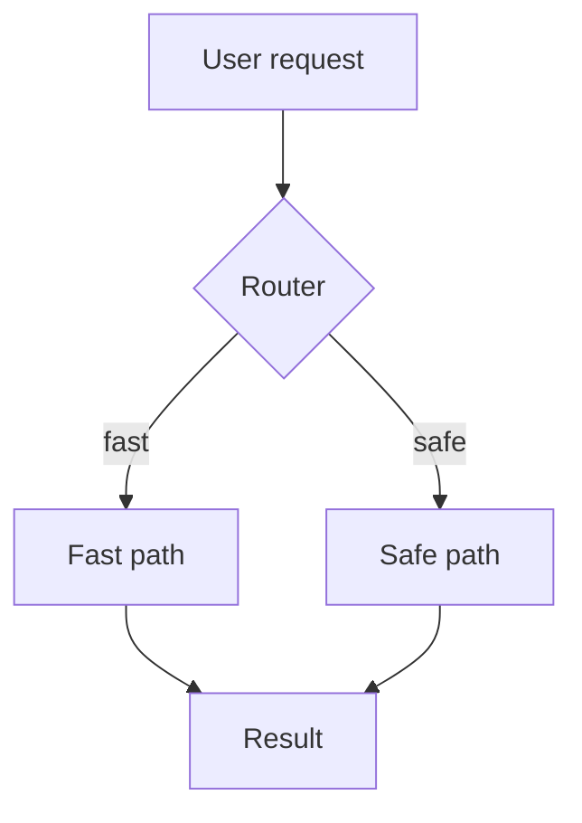
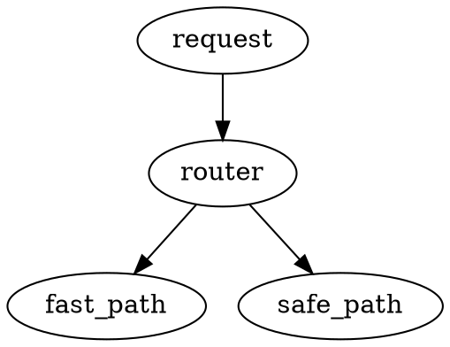

# Pipeline Diagram

The diagram below shows how a request flows through the pipeline.

The same flow in Graphviz:

Run the loader with `pipeline-cli load --file config/widget.yaml` before starting.

| Command | Purpose |
|:---|:---|
| `pipeline-cli load` | Load a configuration file |
| `pipeline-cli run` | Start the pipeline |

See the log in var/log/pipeline.log when a step fails.
