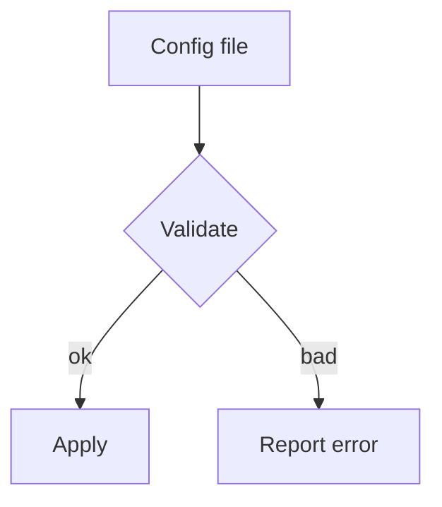

# Sample Widget

The widget reads a configuration file and applies it to the running pipeline.
It is built on top of the subagent runtime, so every load happens out of process.

## Configuration

The widget loads its settings from `config/widget.yaml` each time it starts.
Every entry in that file maps to one field of the widget.

| Field | Type | Description |
|:---|:---|:---|
| `name` | string | The display name shown in the dashboard |
| `retries` | integer | How many times to retry a failed step |
| `mode` | string | Either `fast` or `safe`; see the `mode` key below |

The load order is:

- Read the file from disk.
- Validate every field against the schema.
- Apply the settings to the running pipeline.

To reload a running widget:

1. Stop the pipeline.
2. Reload the configuration.
3. Start the pipeline again.

> Note: the subagent runtime caches the configuration for one minute.

### Loading

The loader binary is named pipeline-cli and lives in /usr/local/bin.
Run it once before starting the pipeline.

Load it with `pipeline-cli load --file config/widget.yaml`, then check the log.

See [the configuration guide](https://example.com/guide) for the full schema.[^1]

```bash
pipeline-cli load --file config/widget.yaml \
  --strict
```




<!-- keep this comment -->

[^1]: https://example.com/notes The guide covers every field in the table.
