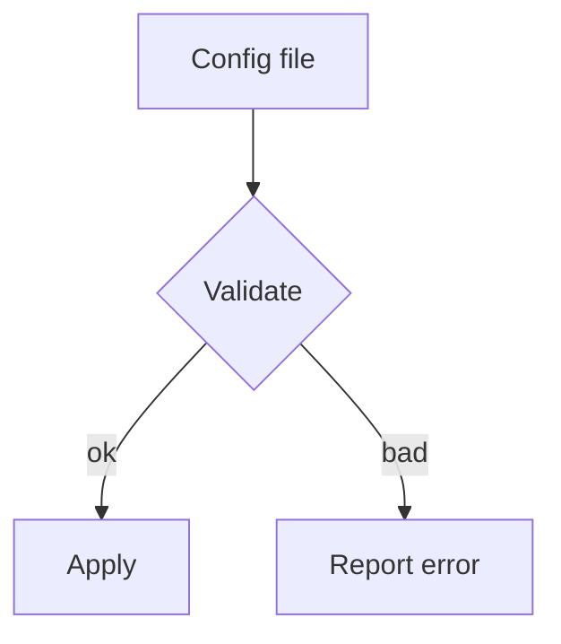
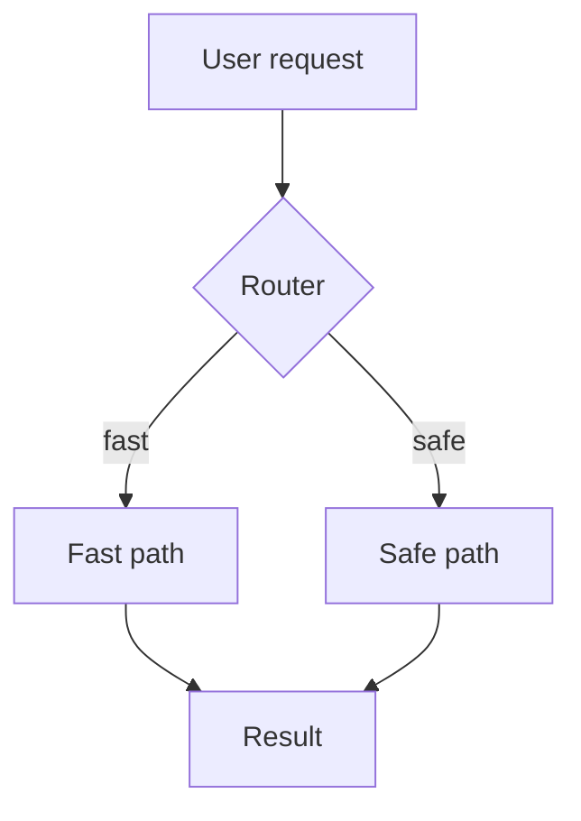
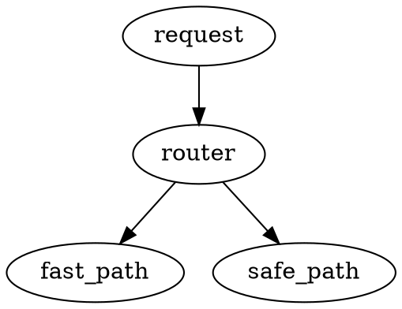

# 测试数据需求

执行这批测试规程所需的数据，逐条列出。DATA-1 至 DATA-3 是三份要交给技能翻译的英文文档，DATA-4 是一对「英文 .md 加它已有的中文版」，DATA-5 与 DATA-6 是两个目录样本（摆法见各条描述）。六份样本的正文都写在表下面，落成时照搬；每份按 UTF-8（无 BOM）存，**末尾都有一个换行符**。

| 唯一标识符 | 英文名 | 描述 | 重置需求 |
|:---|:---|:---|:---|
| DATA-1 | sample_widget_guide | 各类元素齐全的英文文档样本，文件名 `widget-guide.md`：frontmatter 里有 `name`、`description`、`context`、`argument-hint` 四个字段；正文依次放进——一级、二级、三级标题各一处；段落若干（其中一段的段内带硬换行）；一个术语（`subagent`）出现两次，一次在正文段落、一次在引用块；无序列表与有序列表各一处；引用块一处；表格一张（表头四个字的行、纯代码单元格、文字与行内代码混排的单元格、纯文本单元格都有）；` ```bash ` 与 ` ```mermaid ` 代码块各一处，mermaid 图里有带标号的节点 label；行内代码若干（含文件路径与命令）；一条链接；一处正文里不带反引号的英文命令与路径；脚注定义一处加正文引用一处；图片一处；HTML 注释一处。**正文见下面。** | 跑完复位成原样（这条用例会在它旁边产出一份中文版；复位就是删掉产出、把这份恢复成下面的正文） |
| DATA-2 | sample_pipeline_diagram | 代码与图表密集的英文文档样本，文件名 `pipeline-diagram.md`：` ```mermaid ` 图一处（五个节点、带条件 label）、` ```dot ` 图一处、` ```bash ` 代码块一处；行内代码若干；表格一张（表头与文本单元格、纯代码单元格都有）；正文里不带反引号的路径一处。**正文见下面。** | 跑完复位成原样（同上） |
| DATA-3 | sample_release_notes | 没有 frontmatter 的英文文档样本，文件名 `release-notes.md`：一级标题一处、二级标题一处、段落三处，其中两处段内带硬换行；没有 frontmatter。**正文见下面。** | 跑完复位成原样（同上） |
| DATA-4 | handbook_pair | 一对文档，摆在同一个目录里：`handbook.md` 与它已有的中文版 `handbook-中文版.md`。**两份的正文见下面。** | 跑完复位成原样（TC-10 若走了重译覆盖，这份中文版就变了；两种实际行为都记完再复位） |
| DATA-5 | mixed_directory | 目录样本，目录名 `mixed`，里面按下面摆四份文件：`widget-guide.md`（正文照 DATA-1）、`pipeline-diagram.md`（正文照 DATA-2）、`handbook.md` 与 `handbook-中文版.md`（正文照 DATA-4）。其中前两份是没有中文版的待译文件，后一对是「已有中文版」的那一对。TC-4 与 TC-9 都用这个目录，各用各的副本。 | 跑完复位成原样（TC-4 会在前两份旁边各产出一份中文版；TC-9 还会覆盖后一对里的中文版。复位就是把四份文件恢复成跑前的样子） |
| DATA-6 | translated_directory | 目录样本，目录名 `translated`，里面按下面摆四份文件，每一份 .md 都已经有对应的中文版：`handbook.md` 与 `handbook-中文版.md`（正文照 DATA-4）、`release-notes.md` 与 `release-notes-中文版.md`（前者正文照 DATA-3，后者正文见下面）。 | 不需要（这条用例什么都不该动；跑完核对四份文件逐字节没变） |

**DATA-1 的正文**（`widget-guide.md`，落成时原样存成文件）：

````markdown
---
name: sample-widget
description: A widget that loads configuration for the demo pipeline.
context: fork
argument-hint: <config path>
---

# Sample Widget

The widget reads a configuration file and applies it to the running pipeline.
It is built on top of the subagent runtime, so every load happens out of process.

## Configuration

The widget loads its settings from `config/widget.yaml` each time it starts.
Every entry in that file maps to one field of the widget.

| Field | Type | Description |
|:---|:---|:---|
| `name` | string | The display name shown in the dashboard |
| `retries` | integer | How many times to retry a failed step |
| `mode` | string | Either `fast` or `safe`; see the `mode` key below |

The load order is:

- Read the file from disk.
- Validate every field against the schema.
- Apply the settings to the running pipeline.

To reload a running widget:

1. Stop the pipeline.
2. Reload the configuration.
3. Start the pipeline again.

> Note: the subagent runtime caches the configuration for one minute.

### Loading

The loader binary is named pipeline-cli and lives in /usr/local/bin.
Run it once before starting the pipeline.

Load it with `pipeline-cli load --file config/widget.yaml`, then check the log.

See [the configuration guide](https://example.com/guide) for the full schema.[^1]

```bash
pipeline-cli load --file config/widget.yaml \
  --strict
```




<!-- keep this comment -->

[^1]: https://example.com/notes The guide covers every field in the table.
````

**DATA-2 的正文**（`pipeline-diagram.md`）：

````markdown
# Pipeline Diagram

The diagram below shows how a request flows through the pipeline.



The same flow in Graphviz:



Run the loader with `pipeline-cli load --file config/widget.yaml` before starting.

| Command | Purpose |
|:---|:---|
| `pipeline-cli load` | Load a configuration file |
| `pipeline-cli run` | Start the pipeline |

See the log in var/log/pipeline.log when a step fails.
````

**DATA-3 的正文**（`release-notes.md`）：

````markdown
# Release Notes

Version 2.1 fixes the loader bug and improves the cache warm-up time.

## Fixes

The loader no longer fails when the configuration file ends
without a trailing newline.

The cache now warms up in a
single pass.
````

**DATA-4 的正文**（两份，`handbook.md` 与 `handbook-中文版.md`）：

````markdown
# Handbook

This handbook covers the daily routines of the pipeline team.

## Morning checks

Open the dashboard and confirm that every widget reports a green status.
````

````markdown
> 📝 本文为 `handbook.md` 的中文翻译。以英文原文为准；若有出入，请以原文为权威。

# 手册

本手册讲流水线小组的日常事务。

## 晨间检查

打开看板，确认每个组件都报绿色状态。
````

**DATA-6 里 `release-notes-中文版.md` 的正文**：

````markdown
# 发布说明

2.1 版修掉了加载器的缺陷，并缩短了缓存预热时间。

## 修复

配置文件末尾没有换行符时，加载器不再报错。

缓存现在一趟就预热完。
````

六条说明：

——DATA-1 里那几个要判的形态，逐处点一下位置：硬换行在第一段的头两行之间；术语 `subagent` 第一次在「It is built on top of the subagent runtime」这句里，第二次在引用块「Note: the subagent runtime caches…」这句里；不带反引号的命令与路径在「The loader binary is named pipeline-cli and lives in /usr/local/bin.」这一句里；混排单元格是表格第三行第三格；图片与 HTML 注释在文末脚注之前。

——DATA-1 的 frontmatter 里 `context: fork` 是特意放的：依据说「其余字段按值翻译」，照字面读会把这个值译坏。用例判的是实际行为，不判对错。

——DATA-3 没有 frontmatter，是特意留的：说明句该插在哪里，依据没有规定。

——DATA-4 的中文版正文里那条说明句是照翻译规则第三条写的，落成时一字不动照抄——它是「已有的中文版」的样子，不是技能这次的产出。

——DATA-5 与 DATA-6 两个目录里，除了上面点名的文件，不放别的东西；用例判「目录里其他文件一字未动」时，目录里就这几份。

——各份样本落成时摆在哪儿：按各条用例的夹具目录摆（一处工作区里，按环境项 ENV-4 备一份可写的副本）。样本正文改了，用例配置里那几份跟着改。
